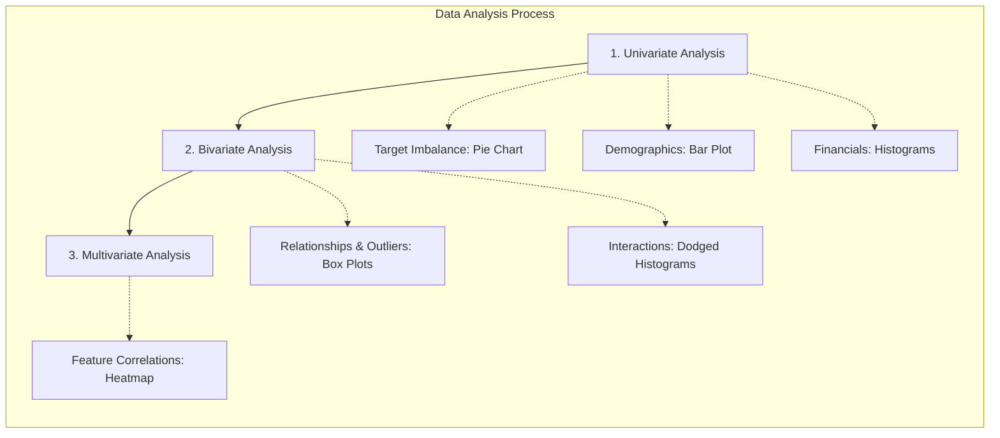

# Loan-Approval-Predictor
An interactive Machine Learning web app built with Streamlit to predict bank loan approvals using classification models
# 🏦 Bank Loan Approval Predictor

## 📌 Project Overview
This project predicts whether a bank loan will be approved or rejected based on an applicant's financial profile. I have performed data analysis and built Machine Learning models to automate the loan approval decision process.

## 🛠️ What I Did (My Work)
1. **Data Preprocessing**: Cleaned the `loan_approval_data.csv` dataset by handling missing values (using median for numbers and mode for text).
2. **Feature Engineering**: Transformed existing data (like squaring the DTI ratio and Credit Score) and converted categorical text data (like 'Rural', 'Urban') into numerical format using One-Hot Encoding so the ML models can understand it.
3. **Feature Scaling**: Applied `StandardScaler` to bring all numerical features to the same scale, which is highly required for distance-based algorithms.
4. **Model Training**: Trained two different classification models to compare their performance:
   * **K-Nearest Neighbors (KNN)**
   * **Naive Bayes (Gaussian)**

## 📊 Output & Results
* The models successfully learned to classify and predict the `Loan_Approved` status.
* I evaluated the models using **Accuracy, Precision, Recall, and Confusion Matrix**.
* **Result**: Both models were successfully able to predict the loan status on unseen test data, with Naive Bayes showing strong precision in identifying true loan approvals.

## 📂 Repository Files
* `credit_wise.ipynb`: The main Jupyter Notebook containing the complete step-by-step code for EDA, feature engineering, and model training.
* `loan_approval_data.csv`: The raw dataset used for this project.

## 🔍 Exploratory Data Analysis (EDA)

Before building the predictive model, we conducted a comprehensive Exploratory Data Analysis to uncover underlying patterns, distributions, and relationships within the dataset. This crucial step informed our feature engineering and modeling strategies.

### 📊 EDA Workflow Diagram

### 1. Target Variable Distribution (Class Imbalance)
Our initial analysis focused on the target variable, `Loan_Approved`. A pie chart visualization revealed a significant class imbalance:
* **No (Loan Denied):** 70.2%
* **Yes (Loan Approved):** 29.8%

This imbalance highlights the need for specialized evaluation metrics, such as the F1-score, rather than relying solely on accuracy.

### 2. Demographic Insights: Education Level
We examined the educational background of the applicants. The bar plot indicates a clear majority:
* **Graduates:** 722 applicants
* **Not Graduates:** 278 applicants

### 3. Financial Distributions
We analyzed the distributions of key financial attributes using histograms:
* **Applicant Income:** The distribution shows a wide range of incomes, with a notable peak around the 10,000 to 11,000 mark. The distribution is somewhat uniform across the lower and middle brackets before tapering off at higher income levels.
* **Coapplicant Income:** This distribution is also varied, with a very prominent spike around the 5,000 range.

### 4. Outlier Detection and Feature Relationships
We utilized box plots to identify outliers and understand how numerical features relate to the loan approval status:
* **Applicant Income vs. Loan Approval:** The median applicant income appears slightly higher for approved loans compared to denied loans, though the interquartile ranges overlap significantly. Both categories exhibit a wide spread of income levels.
* **Multivariate Box Plots:** We expanded this analysis to compare `Loan_Approved` against `Applicant_Income`, `Credit_Score`, `DTI_Ratio`, and `Savings`. 
  * Notably, the **Credit Score** shows a stark difference; approved loans are strongly associated with higher median credit scores compared to denied loans.
  * Conversely, the **DTI Ratio** (Debt-to-Income) is generally lower for approved loans.

### 5. Interaction Analysis
To deeper understand feature interactions, we used dodged histograms:
* **Credit Score by Loan Approval:** This visualization powerfully reinforces the box plot findings. The distribution of denied loans is heavily skewed towards lower credit scores, while approved loans are concentrated at higher scores.
* **Applicant Income by Loan Approval:** This shows that while income is a factor, it is less definitive than credit score. Both approved and denied applications exist across almost all income brackets.

### 6. Correlation Matrix
Finally, we generated a comprehensive heatmap of the correlation matrix for all features (including one-hot encoded variables). 
* This visual tool helps identify multicollinearity (where independent variables are highly correlated with each other) and strong predictors.
* The heatmap visually confirms the strong positive correlation between `Credit_Score` and `Loan_Approved` and negative correlations with features like `DTI_Ratio`.

> 

